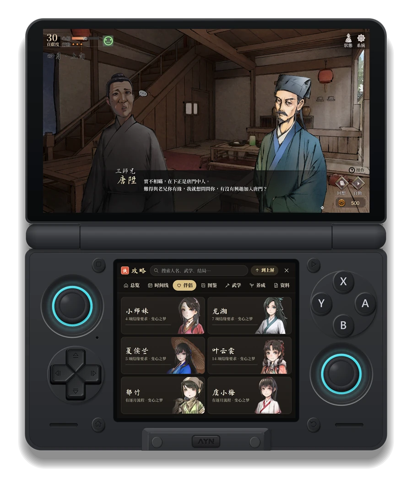
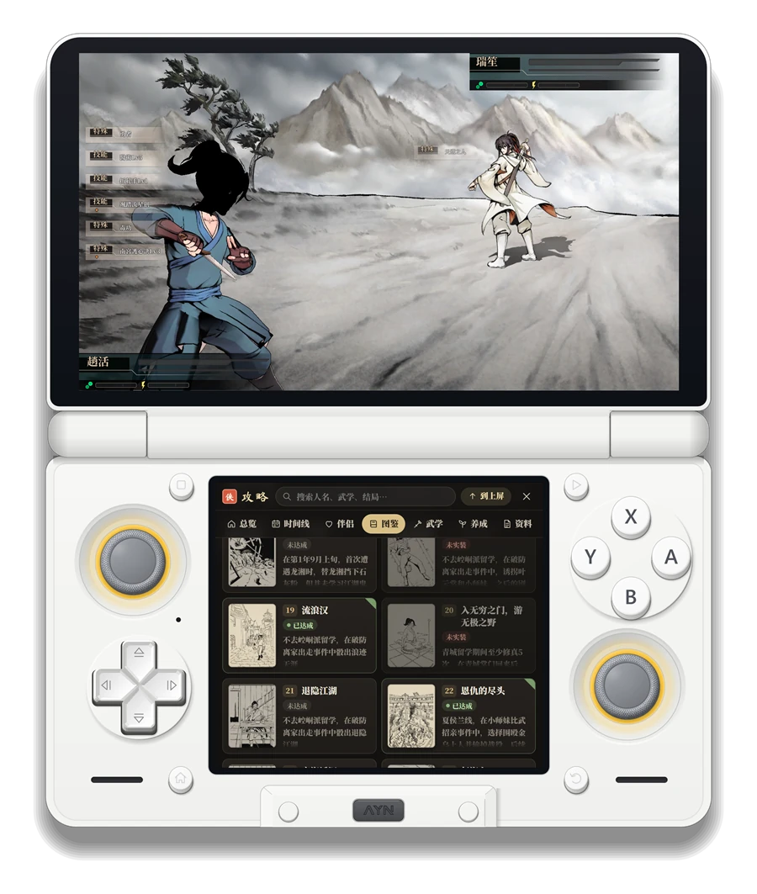
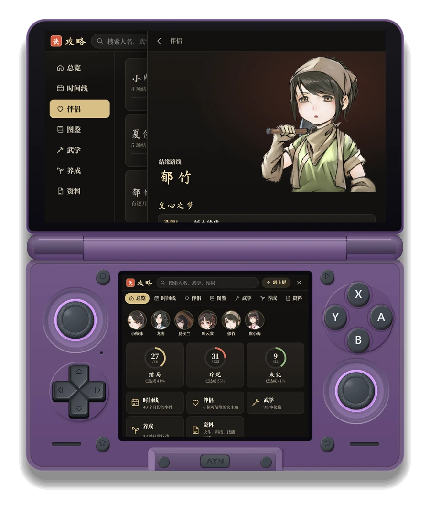
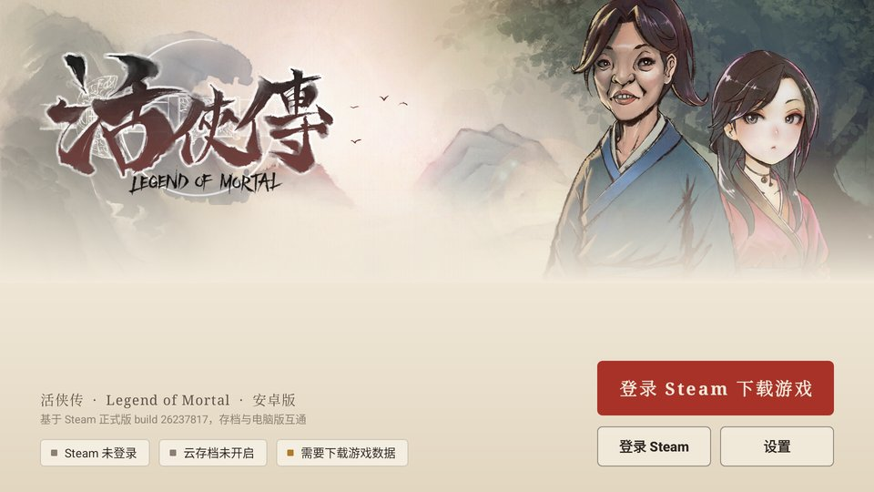
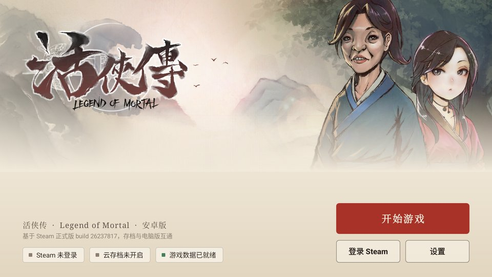
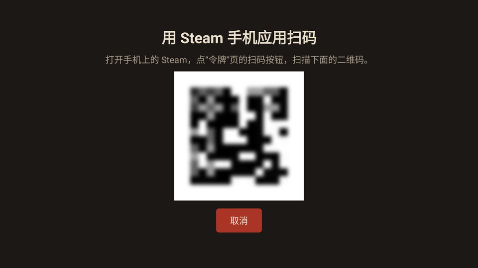
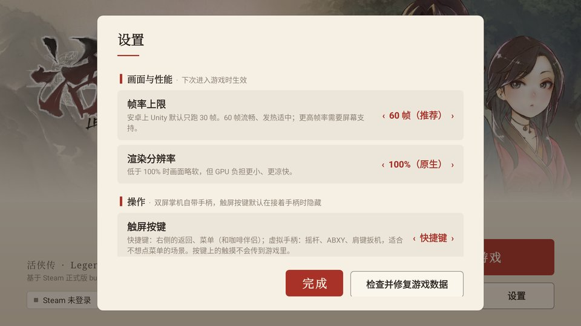
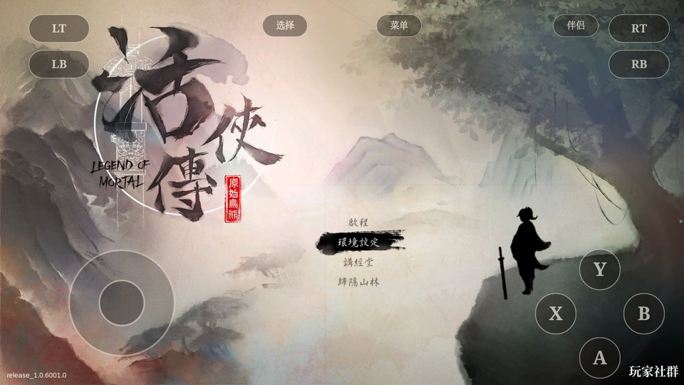
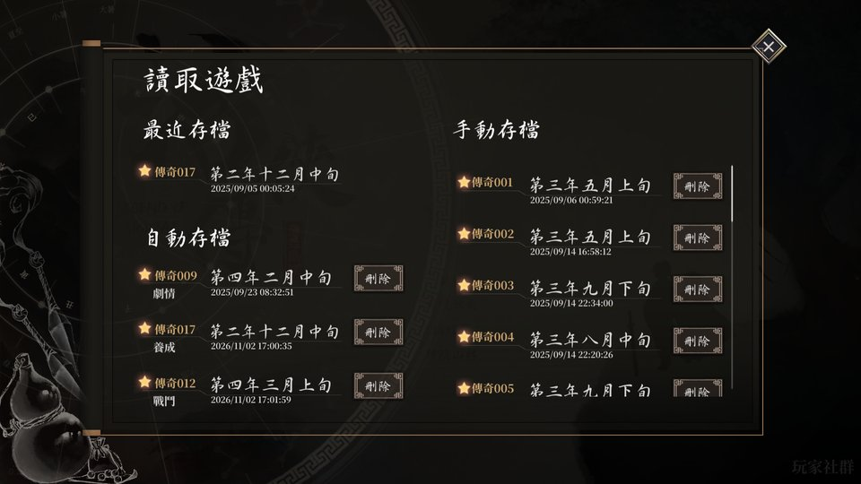
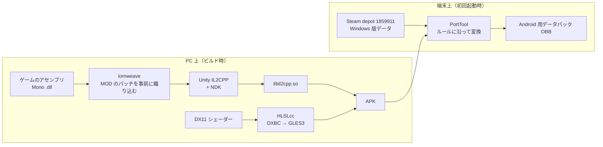

<p align="center"></p>

<p align="center"><a href="README.md">中文</a> · <b>日本語</b> · <a href="README.ko.md">한국어</a></p>

<h1 align="center">活俠傳 · Android ネイティブ版</h1>

<p align="center">
Steam 版『活俠傳 Legend of Mortal』を arm64 の Android アプリとして再コンパイルしたものです。<br>
エミュレーターも Windows 互換レイヤーも使わず、ゲームデータは自分の Steam アカウントからダウンロードします。
</p>

<p align="center">


</p>

---

## なぜ作ったのか

活俠傳は Windows 版しかありません。Android の携帯ゲーム機で遊ぶには、これまで Winlator や GameHub で PC 版を動かすしかなく、遊べはするものの、バッテリーの減りが早く、本体も熱くなり、ときどきカクつき、ロードも遅めでした。

活俠傳は Unity 製で、PC 版のゲームロジックは Mono のマネージドコードです。そこで別の道がとれます。ゲーム自身のアセンブリを同じバージョンの Unity IL2CPP で arm64 のネイティブライブラリにコンパイルし、リソース・シェーダー・音声を Android で使える形に置き換える。このリポジトリは、そのために必要なツールと改造一式です。

主に AYN Thor（Snapdragon 8 Gen 2、上下 2 画面）でテストしていますが、普通の 1 画面の Android 端末でも動きます。

## Thor での見た目

<table>
<tr>
<td width="50%"></td>
<td width="50%"></td>
</tr>
<tr>
<td align="center"><sub>上画面でストーリーを進めながら、下画面で伴侶ルートを確認</sub></td>
<td align="center"><sub>決闘中に下画面でエンディング図鑑を見る</sub></td>
</tr>
</table>

<p align="center"><br>
<sub>攻略ページは丸ごと上画面へ移して、ゲームの上に重ねて読めます。下画面には概要を残したまま</sub></p>

> 本体のフレームは自作のスクリーンショットツール Thor Capture の描画コードで合成しています。画面の中身は実際のスクリーンショットです（攻略ページの数枚は PC 上のプレビューを撮ったもの）。

## できること

**ゲーム本体**

- ストーリー、育成、決闘、戦役、ムービーまで通しで遊べます。セーブデータは PC 版と同じ形式です
- フレームレートは設定可能で、標準は 60fps（Android 版 Unity は既定で 30fps に固定されます）
- 描画解像度も変更でき、携帯機では少し下げて電池を持たせることもできます
- ゲームパッドはそのまま使えます。パッドがないときはタッチボタンを表示でき、「ショートカット」と「仮想パッド」の 2 種類から選べます。パッドをつなぐと自動で隠れます

**Steam**

- Steam モバイルアプリで QR コードを読み取ってログインします。端末でパスワードを入力する必要はありません
- 初回起動時に Steam から Windows 版のデータ（約 2.2 GB）をダウンロードし、端末上で Android 用のデータパックに変換します。アップデート後は変わった部分だけを取りに行きます
- クラウドセーブは双方向で同期します。PC で途中まで遊んで、続きを携帯機で
- フレンドリストには「プレイ中」と表示され、プレイ時間もちゃんと加算されます
- 実績は Steam に反映され、解除したときは画面下にカードが出ます

**LOMAssistant（咖啡伴侶）と 2 画面**

- [LOMAssistant](https://github.com/kevinnie2003/LOMAssistant) 3.4.0 を内蔵しています。ストーリーマップ、ルート、エンディング早見表、いつでもセーブ、イベント選択、AI との会話まで使えます
- Thor では、MOD のウィンドウを丸ごと下画面に移し、上画面はゲーム画面だけにできます。マップの建物、選択肢の結果、分岐条件のヒントも下画面に出ます
- 起動画面で「オフ」「通常版（ゲーム内にウィンドウ）」「2 画面版」を選べます

**攻略**

- Steam コミュニティにある活俠傳のガイド 3 本を、テーマごとに組み直しました。年表、伴侶ルート、エンディング／突然死／実績の図鑑、武学の秘伝書、育成行動、仕組みの資料
- ゲーム内の立ち絵、書物アイコン、汗青書の挿絵を添え、図鑑ではセーブデータの達成状況と照らし合わせます
- ガイドの原文はアプリに同梱しておらず、初回に端末上でダウンロードします。以降はオフラインでも読めます

## スクリーンショット

<table>
<tr>
<td width="50%"></td>
<td width="50%"></td>
</tr>
<tr>
<td align="center"><sub>初回起動：Steam にログインしてゲームデータをダウンロード</sub></td>
<td align="center"><sub>データが揃えば、普段はそのままゲームへ</sub></td>
</tr>
<tr>
<td></td>
<td></td>
</tr>
<tr>
<td align="center"><sub>Steam の QR コードログイン</sub></td>
<td align="center"><sub>設定は端末に合わせて分類。2 画面の項目は 2 枚目の画面があるときだけ出ます</sub></td>
</tr>
<tr>
<td></td>
<td></td>
</tr>
<tr>
<td align="center"><sub>仮想パッドモード</sub></td>
<td align="center"><sub>ロード画面。セーブは PC 版と共通です</sub></td>
</tr>
</table>

## しくみ



ポイントをいくつか：

- **コード**：PC 版には IL2CPP のビルド成果物はありませんが、Mono のアセンブリは完全な形で入っています。同じ Unity 2020.3.49f1 の `il2cpp.exe` と NDK で直接コンパイルしており、Unity エディターも Unity アカウントも使いません。
- **LOMAssistant**：元の MOD は BepInEx と Harmony で実行時にメソッドを書き換えますが、IL2CPP ではそれができません。そこでコンパイル前に 287 個のパッチをゲームのアセンブリへ織り込み、同名の BepInEx / Harmony の代役を用意しました。
- **シェーダー**：106 個のシェーダーのうち 100 個は DX11 版しかありません。DXBC から GLSL ES 3.0 に逆コンパイルし、Unity が必要とするリフレクション情報を補っています。650 バリアント中 649 個が変換できました。
- **音声**：ゲームは Wwise を使っていますが、公式の Android ライブラリにはアカウントが必要です。代わりに Wwise のイベント階層どおりに自前で再生しています。BGM はエントリー／イグジットのキューでシームレスにループし、ミックスのゲインや RTPC カーブは PC 版に合わせています。
- **データ**：Windows 版のテクスチャは DXT5 で、Thor の Adreno 740 はそのまま扱えるため変換は不要です。PortTool は各ファイルを「そのままコピー／ヘッダー変更／bundle ヘッダー変更／パッチ適用／APK 同梱のものを使う」に振り分けて端末上で処理します。パッチは全部合わせても 1 MB 未満です。
- **Steam**：すべて Java 側の JavaSteam で処理しており、ログイン、depot のダウンロード、クラウドセーブ、実績、オンライン状態のどれもゲームのコードを通りません。もともとの Steamworks 呼び出しは空の実装に置き換え、実績だけを Java 側に渡しています。

## リポジトリ構成

```
art/        起動画面のアート（Steam のライブラリ画像）とアプリアイコン
cloud/      Java 側：起動画面、Steam ログイン／ダウンロード／クラウドセーブ／実績、タッチボタン、設定
docs/       この説明で使っている画像
shots/      開発中の確認用スクリーンショット
tools/
  lomtool/      リソース・シェーダー・音声の処理（C#、AssetsTools.NET）
  lomweave/     MOD をゲームのアセンブリに織り込み、代役のアセンブリを生成
  lomandroid/   ゲーム内の Android 対応コード（フレームレート、音声、タッチ入力）
  porttool/     PC データ → Android データパックの変換ルール
  hlslcc-cli/   HLSLcc のバッチ処理フロントエンド
  build-*.sh    ビルドスクリプト
HANDOFF.md  開発記録：各ステップで何をして、どう確かめ、どこでつまずいたか（中国語）
MOD-PORT.md LOMAssistant 移植の詳細（中国語）
```

下画面のコンパニオンと攻略ページのウェブ部分は別のリポジトリ（lom-thor-probe）にあり、ビルド時に一緒に APK へ入ります。

## 自分でビルドする

必要なものはすべて Windows 上に揃えます：

- 正規版の活俠傳（Steam）。アセンブリと照合用データの取得に使います
- Unity 2020.3.49f1 の Android IL2CPP コンポーネント（使うのは中の `il2cpp.exe` とランタイムだけ）
- Android NDK r19c、Android SDK build-tools、JDK 17 以上（cloud は Gradle でビルド）
- .NET 8 SDK（lomtool、lomweave のビルド用）
- Git Bash

おおまかな手順：

```bash
# 1. il2cpp の入力を組み立て、リソースとシェーダーを変換（初回はかなり時間がかかります）
bash tools/rebuild.sh

# 2. MOD を織り込み、IL2CPP をコンパイルし、MOD 入りの APK をパッケージ
NO_OBB=1 bash tools/lomweave/build-mod.sh
```

できあがるのは約 400 MB の APK です。端末に入れて初めて起動すると、Steam へのログインとデータのダウンロードに案内されます。端末のシリアルは環境変数 `ANDROID_SERIAL`、SDK の場所は `ANDROID_SDK_ROOT` で指定します。細かいパラメーターやパス、各スクリプトの役割は [HANDOFF.md](HANDOFF.md) を見てください。

## 現状

普通に遊べます。ニューゲーム、ストーリー進行、決闘、セーブとロードは一通り動作を確認済みです。Thor のセーブと Steam クラウド、PC のセーブが同じものであることを照合し、フレンドリストの「プレイ中」表示と実績も一致しています。

まだ終わっていない、または確認していないこと：

- 実際の Steam アカウントでゼロからデータ一式をダウンロードする流れは、まだエミュレーターでしか通していません。実機は確認中です
- フレームレートは大まかに測っただけで、場面ごとの系統的な計測はまだです
- 仮想パッドモードでは、ボタンが MOD のウィンドウに一部かぶります
- 攻略ページは追加したばかりで、実機で確認中です
- ビルドは arm64 のみで、32bit や x86 版はありません

## 注意事項

- このリポジトリには**ゲームのファイルは一切含まれていません**。ゲームデータは自分の Steam アカウントからダウンロードするので、ゲームを購入していなければアプリは使えません。
- LOMAssistant（咖啡伴侶）の著作権は原作者にあります。ここでは Android 版で動くように移植しただけです。
- 攻略の内容は Steam コミュニティのガイド 3 本（作者 RICK、翩翩风吹雪、Speary）に基づきます。アプリは端末上で原文をダウンロードして独自に整理しており、原文を転載していません。
- 活俠傳とそのアートの著作権は、開発元およびパブリッシャーに帰属します。
- 個人の研究プロジェクトであり、公式とは関係ありません。
