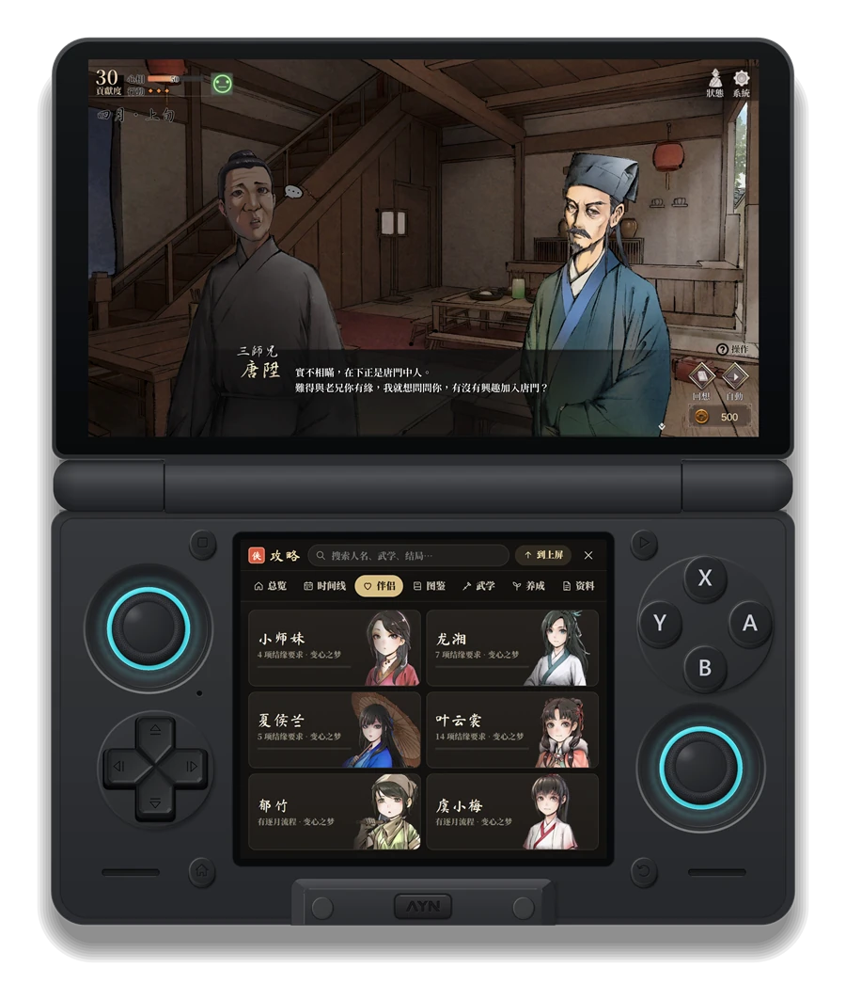
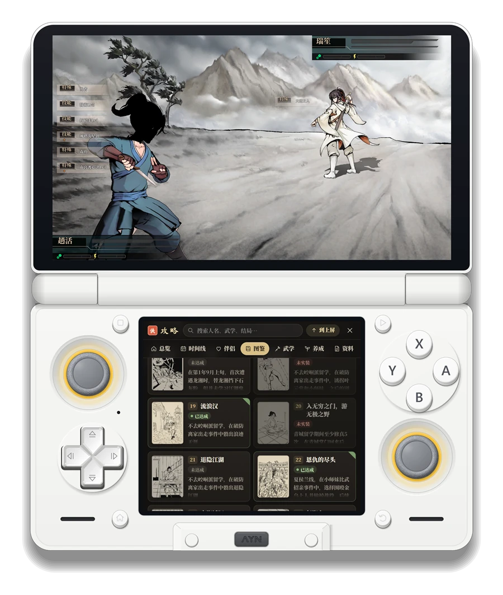
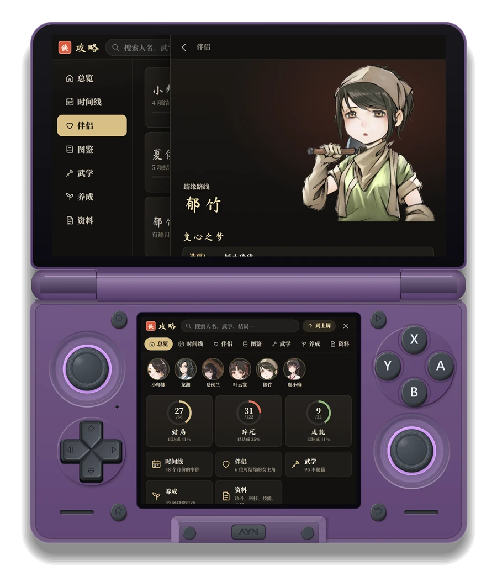
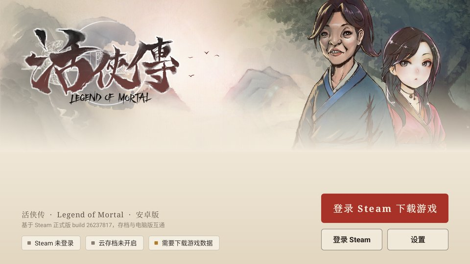
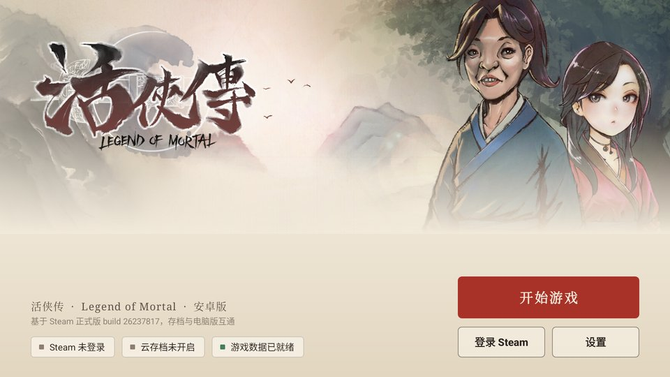
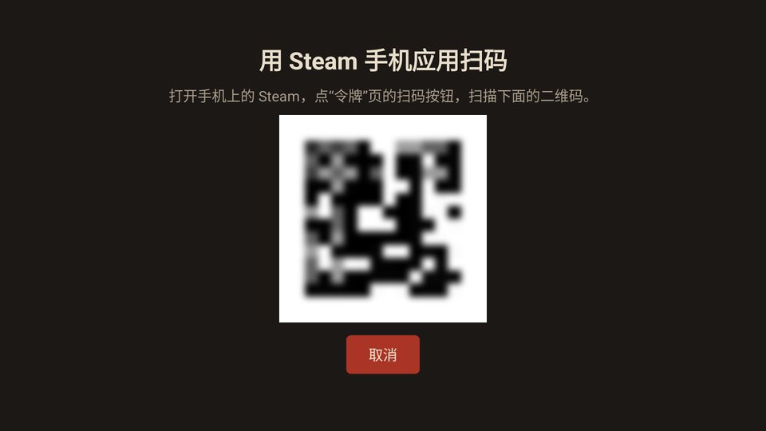
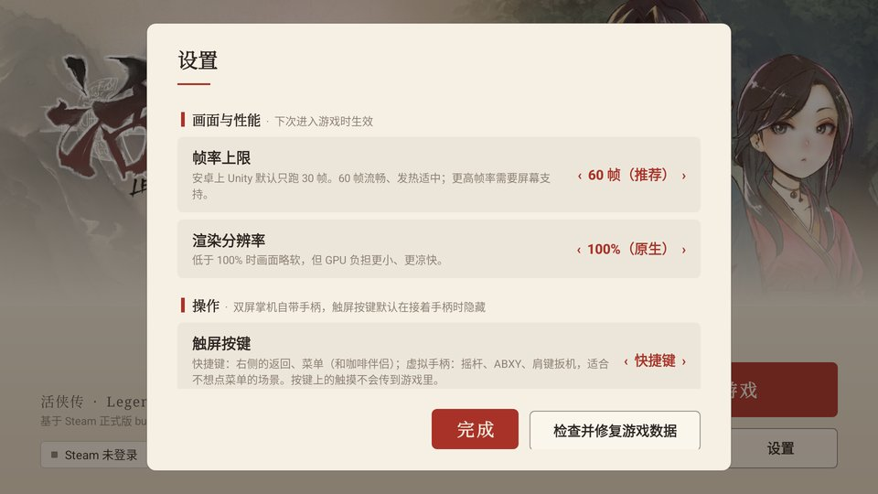
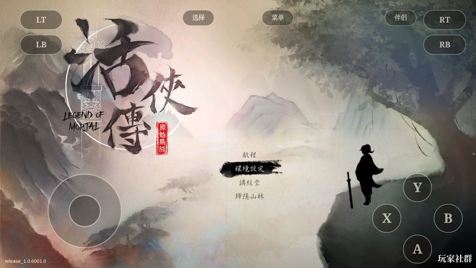
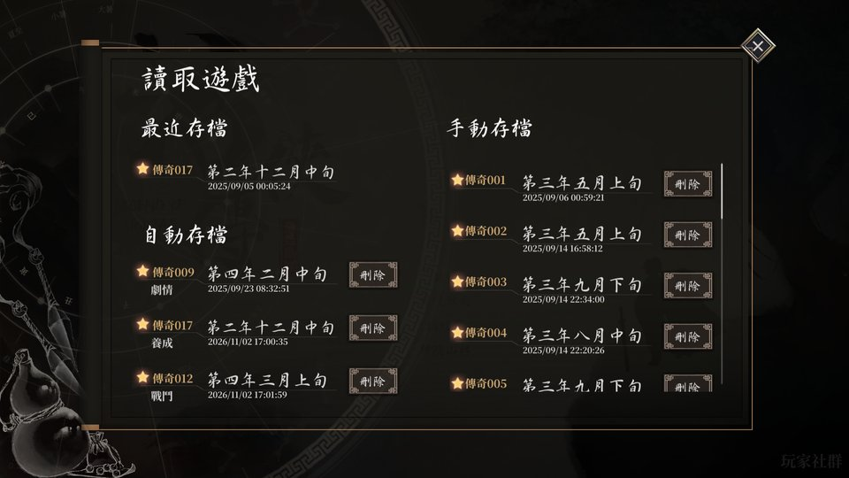
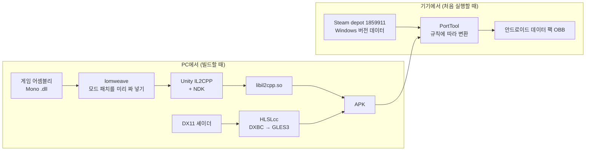

<p align="center"></p>

<p align="center"><a href="README.md">中文</a> · <a href="README.ja.md">日本語</a> · <b>한국어</b></p>

<h1 align="center">활협전 · 안드로이드 네이티브 버전</h1>

<p align="center">
Steam 판 『활협전 Legend of Mortal』을 arm64 안드로이드 앱으로 다시 컴파일한 프로젝트입니다.<br>
에뮬레이터나 Windows 호환 레이어 없이 돌아가며, 게임 데이터는 본인의 Steam 계정에서 내려받습니다.
</p>

<p align="center">


</p>

---

## 왜 만들었나

활협전은 Windows 버전만 있습니다. 안드로이드 휴대용 기기에서 하려면 지금까지는 Winlator나 GameHub로 PC 버전을 돌리는 수밖에 없었는데, 플레이는 되지만 배터리가 빨리 닳고, 기기가 뜨거워지고, 가끔 끊기고, 로딩도 느렸습니다.

활협전은 Unity로 만들어졌고, PC 버전의 게임 로직은 Mono 관리 코드입니다. 그래서 다른 길이 있습니다. 게임 자체의 어셈블리를 같은 버전의 Unity IL2CPP로 arm64 네이티브 라이브러리로 컴파일하고, 리소스·셰이더·오디오를 안드로이드에서 쓸 수 있는 형태로 바꾸는 것입니다. 이 저장소는 그 과정에 필요한 도구와 수정 사항을 모두 담고 있습니다.

주로 AYN Thor(스냅드래곤 8 Gen 2, 위아래 듀얼 스크린)에서 테스트했고, 일반 싱글 스크린 안드로이드 폰에서도 됩니다.

## Thor에서 보면

<table>
<tr>
<td width="50%"></td>
<td width="50%"></td>
</tr>
<tr>
<td align="center"><sub>위 화면에서 스토리를 진행하면서 아래 화면으로 반려 루트 확인</sub></td>
<td align="center"><sub>결투 중에 아래 화면으로 엔딩 도감 보기</sub></td>
</tr>
</table>

<p align="center"><br>
<sub>공략 페이지는 통째로 위 화면으로 옮겨 게임 위에 띄워 볼 수 있습니다. 아래 화면에는 요약이 그대로 남습니다</sub></p>

> 기기 프레임은 직접 만든 스크린샷 도구 Thor Capture의 그리기 코드로 합성했습니다. 화면 안은 실제 스크린샷입니다(공략 페이지 몇 장은 PC에서 미리보기를 찍은 것).

## 할 수 있는 것

**게임 본편**

- 스토리, 육성, 결투, 전역, 영상까지 처음부터 끝까지 플레이할 수 있고, 세이브는 PC 버전과 같은 형식입니다
- 프레임 레이트를 설정할 수 있고 기본값은 60fps입니다(안드로이드판 Unity는 기본으로 30fps에 묶여 있습니다)
- 렌더링 해상도도 조절할 수 있어서, 휴대용 기기에서는 조금 낮춰 배터리를 아낄 수 있습니다
- 게임패드는 바로 쓸 수 있습니다. 패드가 없을 때는 터치 버튼을 켤 수 있고 '단축키'와 '가상 패드' 두 가지가 있으며, 패드를 연결하면 자동으로 숨겨집니다

**Steam**

- Steam 모바일 앱으로 QR 코드를 찍어 로그인합니다. 기기에서 비밀번호를 입력할 필요가 없습니다
- 처음 실행할 때 Steam에서 Windows 버전 데이터(약 2.2GB)를 내려받아 기기에서 안드로이드용 데이터 팩으로 변환합니다. 게임이 업데이트되면 바뀐 부분만 받습니다
- 클라우드 세이브는 양방향으로 동기화됩니다. PC에서 하다가 휴대용 기기로 이어서 할 수 있습니다
- 친구 목록에 '게임 중'으로 표시되고 플레이 시간도 그대로 쌓입니다
- 도전 과제는 Steam에 반영되고, 달성하면 화면 아래에 알림 카드가 뜹니다

**LOMAssistant와 듀얼 스크린**

- [LOMAssistant](https://github.com/kevinnie2003/LOMAssistant) 3.4.0이 들어 있습니다. 스토리 맵, 루트, 엔딩 요약표, 언제든 저장, 이벤트 선택, AI 대화까지 모두 쓸 수 있습니다
- Thor에서는 모드 창을 통째로 아래 화면으로 옮기고 위 화면에는 게임만 남길 수 있습니다. 지도 건물, 선택지 결과, 분기 조건 힌트도 아래 화면에 뜹니다
- 시작 화면에서 '끄기', '일반판(게임 안에 창)', '듀얼 스크린판' 중에서 고를 수 있습니다

**공략**

- Steam 커뮤니티에 있는 활협전 가이드 세 편을 주제별로 다시 정리했습니다. 연표, 반려 루트, 엔딩·돌연사·도전 과제 도감, 무학 비급, 육성 행동, 시스템 자료
- 게임 속 캐릭터 일러스트, 서적 아이콘, 한청서 삽화를 곁들였고, 도감은 내 세이브의 달성 상황과 대조해 보여 줍니다
- 가이드 원문은 앱에 포함되어 있지 않고 처음에 기기에서 내려받습니다. 그다음부터는 오프라인으로 볼 수 있습니다

## 스크린샷

<table>
<tr>
<td width="50%"></td>
<td width="50%"></td>
</tr>
<tr>
<td align="center"><sub>첫 실행: Steam에 로그인해 게임 데이터 내려받기</sub></td>
<td align="center"><sub>데이터가 준비되면 평소에는 바로 게임으로</sub></td>
</tr>
<tr>
<td></td>
<td></td>
</tr>
<tr>
<td align="center"><sub>Steam QR 코드 로그인</sub></td>
<td align="center"><sub>설정은 기기에 맞춰 묶여 있고, 듀얼 스크린 항목은 두 번째 화면이 있을 때만 나옵니다</sub></td>
</tr>
<tr>
<td></td>
<td></td>
</tr>
<tr>
<td align="center"><sub>가상 패드 모드</sub></td>
<td align="center"><sub>불러오기 화면. 세이브는 PC 버전과 공용입니다</sub></td>
</tr>
</table>

## 어떻게 만들었나



핵심 몇 가지:

- **코드**: PC 버전에는 IL2CPP 빌드 결과물이 없지만 Mono 어셈블리는 온전히 들어 있습니다. 같은 Unity 2020.3.49f1의 `il2cpp.exe`와 NDK로 바로 컴파일하며, Unity 에디터도 Unity 계정도 필요 없습니다.
- **LOMAssistant**: 원래 모드는 BepInEx와 Harmony로 실행 중에 메서드를 바꾸는데, IL2CPP에서는 그게 안 됩니다. 그래서 컴파일 전에 287개 패치를 게임 어셈블리에 짜 넣고, 같은 이름의 BepInEx / Harmony 대역을 준비했습니다.
- **셰이더**: 셰이더 106개 중 100개는 DX11 버전만 있습니다. DXBC를 GLSL ES 3.0으로 역컴파일하고 Unity가 필요로 하는 리플렉션 정보를 채워 넣었습니다. 변형 650개 중 649개가 변환됩니다.
- **오디오**: 게임은 Wwise를 쓰는데, 공식 안드로이드 라이브러리는 계정이 필요합니다. 대신 Wwise 이벤트 계층대로 직접 재생합니다. 배경음악은 진입/종료 큐 지점으로 끊김 없이 반복하고, 믹스 게인과 RTPC 곡선은 PC 버전을 따릅니다.
- **데이터**: Windows 버전 텍스처는 DXT5이고 Thor의 Adreno 740이 그대로 지원해서 변환할 필요가 없습니다. PortTool은 파일마다 '그대로 복사 / 헤더 변경 / bundle 헤더 변경 / 패치 적용 / APK에 든 것 사용'으로 나눠 기기에서 처리하며, 패치는 다 합쳐도 1MB가 안 됩니다.
- **Steam**: 전부 Java 쪽에서 JavaSteam으로 처리합니다. 로그인, depot 다운로드, 클라우드 세이브, 도전 과제, 온라인 상태 모두 게임 코드를 거치지 않습니다. 원래 Steamworks 호출은 빈 구현으로 바꾸고, 도전 과제만 Java 쪽으로 넘깁니다.

## 저장소 구성

```
art/        시작 화면 아트(Steam 라이브러리 이미지)와 앱 아이콘
cloud/      Java 쪽: 시작 화면, Steam 로그인 / 다운로드 / 클라우드 세이브 / 도전 과제, 터치 버튼, 설정
docs/       이 문서에 쓰인 이미지
shots/      개발 중 확인용 스크린샷
tools/
  lomtool/      리소스·셰이더·오디오 처리(C#, AssetsTools.NET)
  lomweave/     모드를 게임 어셈블리에 짜 넣고 대역 어셈블리를 생성
  lomandroid/   게임 안의 안드로이드 대응 코드(프레임 레이트, 오디오, 터치 입력)
  porttool/     PC 데이터 → 안드로이드 데이터 팩 변환 규칙
  hlslcc-cli/   HLSLcc 일괄 처리 프런트엔드
  build-*.sh    빌드 스크립트
HANDOFF.md  개발 기록: 단계마다 무엇을 했고 어떻게 확인했고 어디서 막혔는지(중국어)
MOD-PORT.md LOMAssistant 이식 상세(중국어)
```

아래 화면 컴패니언과 공략 페이지의 웹 부분은 다른 저장소(lom-thor-probe)에 있고, 빌드할 때 함께 APK에 들어갑니다.

## 직접 빌드하기

필요한 것은 모두 Windows에 준비합니다:

- 정품 활협전(Steam). 어셈블리와 대조용 데이터를 가져오는 데 씁니다
- Unity 2020.3.49f1의 안드로이드 IL2CPP 구성 요소(안에 있는 `il2cpp.exe`와 런타임만 사용)
- Android NDK r19c, Android SDK build-tools, JDK 17 이상(cloud는 Gradle로 빌드)
- .NET 8 SDK(lomtool, lomweave 빌드용)
- Git Bash

대략적인 순서:

```bash
# 1. il2cpp 입력을 조립하고 리소스와 셰이더 변환(처음에는 꽤 오래 걸립니다)
bash tools/rebuild.sh

# 2. 모드를 짜 넣고 IL2CPP를 컴파일한 뒤, 모드가 들어간 APK로 패키징
NO_OBB=1 bash tools/lomweave/build-mod.sh
```

결과물은 약 400MB짜리 APK입니다. 기기에 설치해 처음 실행하면 Steam 로그인과 데이터 다운로드로 안내합니다. 기기 시리얼은 환경 변수 `ANDROID_SERIAL`, SDK 위치는 `ANDROID_SDK_ROOT`로 지정합니다. 자세한 매개변수와 경로, 스크립트별 역할은 [HANDOFF.md](HANDOFF.md)를 보세요.

## 현재 상태

정상적으로 플레이할 수 있습니다. 새 게임, 스토리 진행, 결투, 저장과 불러오기까지 모두 확인했습니다. Thor의 세이브와 Steam 클라우드, PC의 세이브가 같은 것임을 대조했고, 친구 목록의 '게임 중' 표시와 도전 과제도 일치합니다.

아직 끝나지 않았거나 확인하지 못한 것:

- 실제 Steam 계정으로 데이터 전체를 처음부터 내려받는 과정은 아직 에뮬레이터에서만 확인했고, 실기기는 확인 중입니다
- 프레임 레이트는 대략적으로만 쟀고, 장면별로 체계적으로 측정하지는 않았습니다
- 가상 패드 모드에서는 버튼이 모드 창 일부를 가립니다
- 공략 페이지는 막 추가해서 실기기에서 확인 중입니다
- arm64로만 빌드했고 32비트나 x86 버전은 없습니다

## 안내

- 이 저장소에는 **게임 파일이 전혀 들어 있지 않습니다**. 게임 데이터는 본인의 Steam 계정에서 내려받으므로, 게임을 구매하지 않았다면 앱을 쓸 수 없습니다.
- LOMAssistant의 저작권은 원작자에게 있습니다. 여기서는 안드로이드 버전에서 돌아가도록 이식했을 뿐입니다.
- 공략 내용은 Steam 커뮤니티 가이드 세 편(작성자 RICK, 翩翩风吹雪, Speary)을 바탕으로 합니다. 앱이 기기에서 원문을 내려받아 따로 정리하며, 원문을 옮겨 싣지 않습니다.
- 활협전과 그 아트의 저작권은 개발사와 배급사에 있습니다.
- 개인 연구 프로젝트이며 공식과는 관계가 없습니다.
