<p align="center">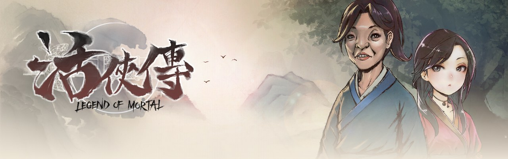</p>

<p align="center"><b>中文</b> · <a href="README.ja.md">日本語</a> · <a href="README.ko.md">한국어</a></p>

<h1 align="center">活侠传 · 安卓原生版</h1>

<p align="center">
把 Steam 上的《活侠传 Legend of Mortal》重新编译成 arm64 安卓应用。<br>
不走模拟器，也不靠 Windows 转译层，游戏数据从你自己的 Steam 账号下载。
</p>

<p align="center">


</p>

---

## 为什么做这个

活侠传只有 Windows 版。在安卓掌机上玩，以前只能用 Winlator、GameHub 这类方案跑 PC 版，能玩，但耗电、发热、偶尔卡顿，读档也慢。

活侠传是 Unity 做的，PC 版是 Mono 托管代码，所以有另一条路：拿游戏自己的程序集，用同版本的 Unity IL2CPP 编成 arm64 原生库，再把资源、着色器和音频换成安卓能用的形式。这个仓库就是这条路上需要的全部工具和改动。

主要在 AYN Thor（骁龙 8 Gen 2，上下双屏）上测试，普通单屏安卓手机也能用。

## 在 Thor 上的样子

<table>
<tr>
<td width="50%">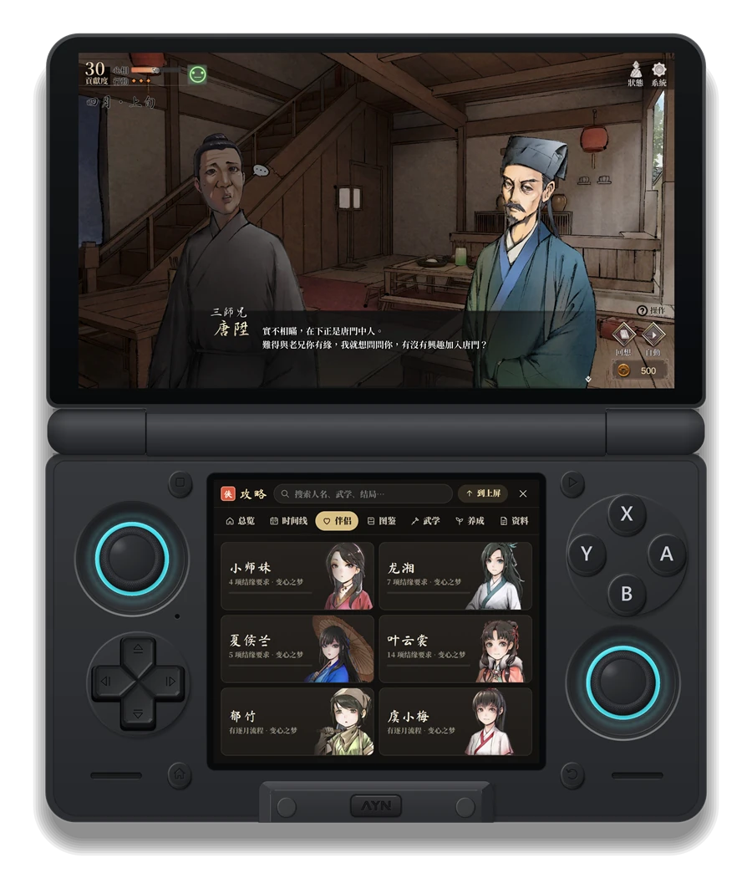</td>
<td width="50%">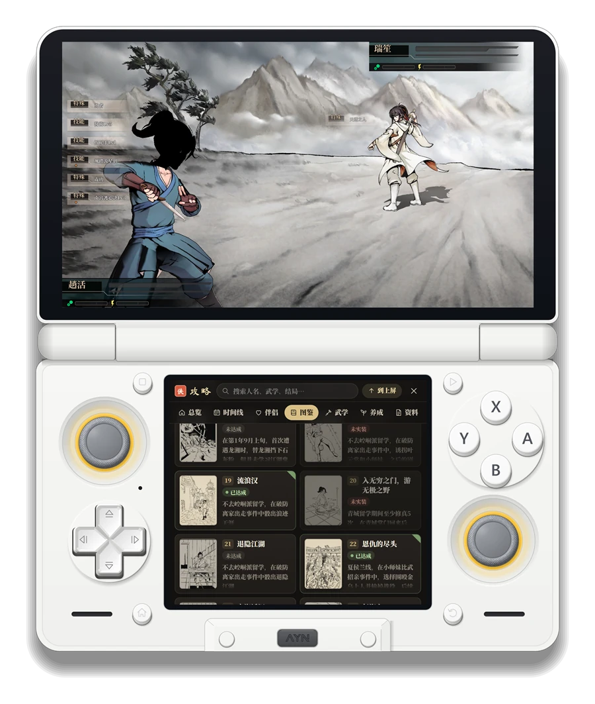</td>
</tr>
<tr>
<td align="center"><sub>上屏走剧情，下屏翻伴侣路线</sub></td>
<td align="center"><sub>决斗时，下屏看结局图鉴</sub></td>
</tr>
</table>

<p align="center">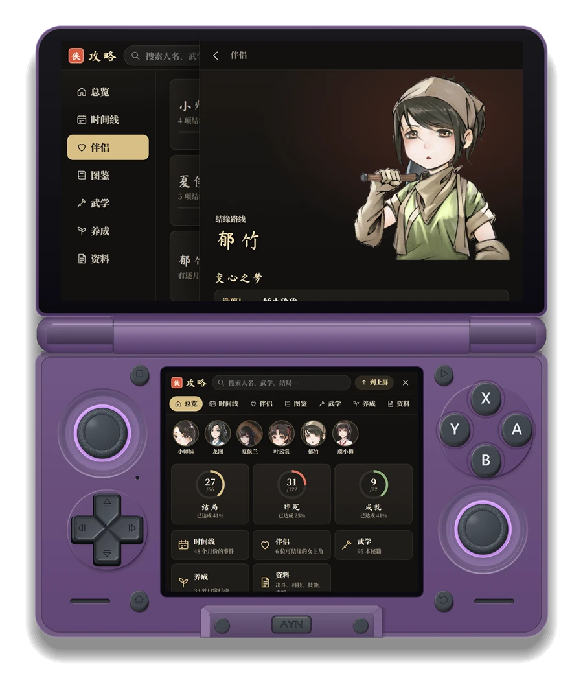<br>
<sub>攻略可以整页换到上屏，盖在游戏上看；下屏留着总览</sub></p>

> 外壳图用自制截图工具 Thor Capture 的外壳绘制代码合成，屏幕里是真实截图（攻略页那几张是电脑上的预览截图）。

## 能做什么

**游戏本体**

- 完整的游戏流程：剧情、养成、决斗、战役、CG 视频，读写和 PC 版同格式的存档
- 帧率可设，默认 60 帧（安卓版 Unity 默认会锁 30）
- 渲染分辨率可调，掌机上可以降一点换续航
- 手柄直接可用；没有手柄时可以开触屏按键，有「快捷键」和「虚拟手柄」两种，接上手柄自动隐藏

**Steam**

- 用 Steam 手机应用扫码登录，不需要在设备上输密码
- 第一次打开时从 Steam 下载 Windows 版数据（约 2.2 GB），在手机上转换成安卓用的数据包；游戏更新后只下载变化的部分
- 云存档双向同步：在电脑上玩到一半，拿起掌机接着玩
- 好友列表里显示「正在玩」，游戏时长照常累计
- 成就会同步到 Steam，解锁时屏幕底部弹出提示卡片

**咖啡伴侣与双屏**

- 内置了 [咖啡伴侣（LOMAssistant）](https://github.com/kevinnie2003/LOMAssistant) 3.4.0：剧情图、路线、结局速查、随时存档、事件自选、AI 陪玩都能用
- 在 Thor 上，伴侣的窗口可以整个搬到下屏，上屏只留游戏画面；地图建筑、选项后果、分支条件的提示也改在下屏弹出
- 启动页里可以选关闭、普通版（窗口在游戏里）或双屏版

**攻略**

- 把 Steam 社区三篇活侠传指南按主题重新整理：时间线、伴侣路线、结局 / 猝死 / 成就图鉴、武学秘籍、养成行动、机制资料
- 配上游戏里的人物立绘、书籍图标和汗青书插图，图鉴会对照你存档里的达成情况
- 指南原文不打包在应用里，第一次打开时在设备上下载，之后离线可看

## 截图

<table>
<tr>
<td width="50%">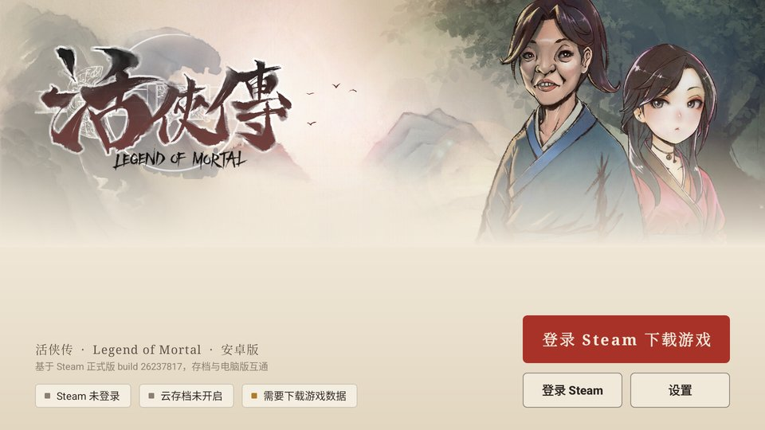</td>
<td width="50%">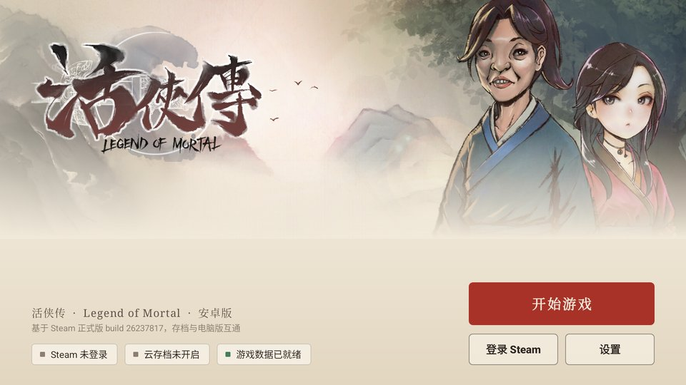</td>
</tr>
<tr>
<td align="center"><sub>第一次打开：登录 Steam 下载游戏数据</sub></td>
<td align="center"><sub>数据就绪后，平时直接进游戏</sub></td>
</tr>
<tr>
<td>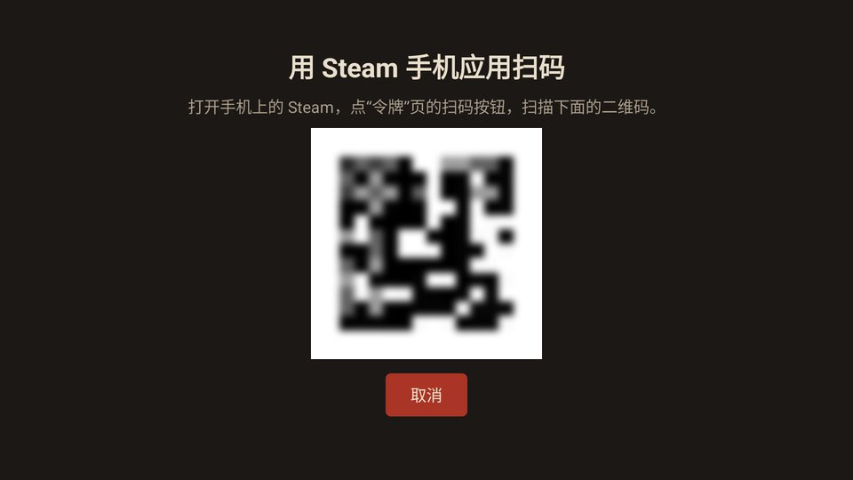</td>
<td>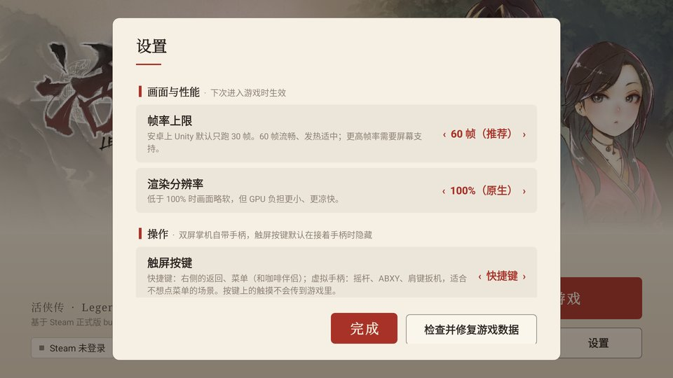</td>
</tr>
<tr>
<td align="center"><sub>Steam 扫码登录</sub></td>
<td align="center"><sub>设置按设备分组，双屏选项只在有第二块屏时出现</sub></td>
</tr>
<tr>
<td>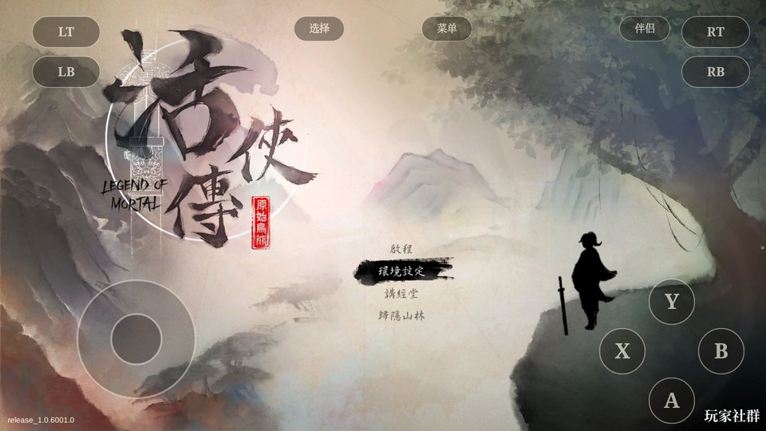</td>
<td>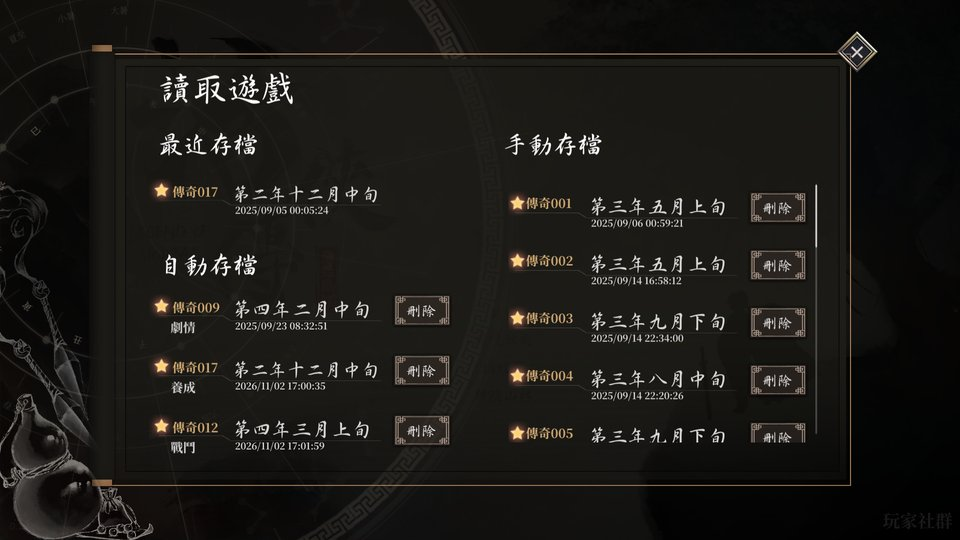</td>
</tr>
<tr>
<td align="center"><sub>虚拟手柄模式</sub></td>
<td align="center"><sub>读档界面，存档和 PC 版通用</sub></td>
</tr>
</table>

## 怎么做到的

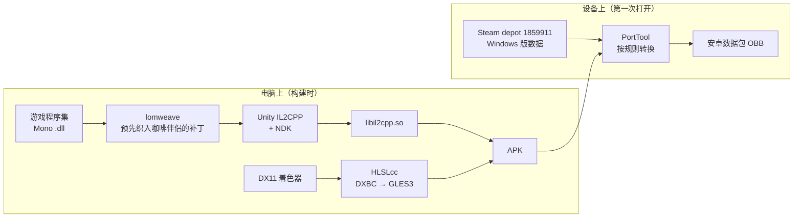

几个关键点：

- **代码**：PC 版没有 IL2CPP 产物，但 Mono 程序集是完整的。用同版本 Unity 2020.3.49f1 的 `il2cpp.exe` 和 NDK 直接编，不打开 Unity 编辑器，也不需要 Unity 账号。
- **咖啡伴侣**：原 Mod 依赖 BepInEx 和 Harmony 在运行时改方法，IL2CPP 做不到。所以在编译前把它的 287 个补丁织进游戏程序集，再给它准备同名的 BepInEx / Harmony 替身。
- **着色器**：106 个 Shader 里 100 个只有 DX11 版本。从 DXBC 反编译成 GLSL ES 3.0，并补上 Unity 需要的反射信息，650 个变体里成功 649 个。
- **音频**：游戏用 Wwise，官方安卓库需要账号。改成自己按 Wwise 的事件层级播放：音乐按入口 / 出口提示点无缝循环，混音增益、RTPC 曲线照 PC 版来。
- **数据**：Windows 版的贴图是 DXT5，Thor 的 Adreno 740 直接支持，不用转码。PortTool 把每个文件分成「原样拷贝 / 改头 / 改 bundle 头 / 打补丁 / 用 APK 自带」几类，设备上逐个处理，补丁总共不到 1 MB。
- **Steam**：全部在 Java 层用 JavaSteam 完成，登录、下载 depot、云存档、成就、在线状态都不经过游戏代码。游戏原来的 Steamworks 调用换成了空实现，只把成就转给 Java 层。

## 仓库结构

```
art/        启动页美术（Steam 库图）和应用图标
cloud/      Java 层：启动页、Steam 登录 / 下载 / 云存档 / 成就、触屏按键、设置
docs/       这份说明用的图片
shots/      开发过程中的验证截图
tools/
  lomtool/      资源、着色器、音频处理（C#，AssetsTools.NET）
  lomweave/     把咖啡伴侣织进游戏程序集，生成替身程序集
  lomandroid/   游戏里的安卓适配代码（帧率、音频、触屏输入）
  porttool/     PC 数据 → 安卓数据包的转换规则
  hlslcc-cli/   HLSLcc 批处理前端
  build-*.sh    构建脚本
HANDOFF.md  开发记录：每一步做了什么、怎么验证、踩过的坑
MOD-PORT.md 咖啡伴侣移植的细节
```

下屏伴侣和攻略页的网页部分在另一个仓库（lom-thor-probe），构建时会一起打进 APK。

## 自己构建

需要准备的东西都在 Windows 上：

- 正版活侠传（Steam），用来取程序集和对照数据
- Unity 2020.3.49f1 的安卓 IL2CPP 组件（只用里面的 `il2cpp.exe` 和运行库）
- Android NDK r19c、Android SDK build-tools、JDK 17 以上（cloud 用 Gradle 构建）
- .NET 8 SDK（构建 lomtool、lomweave）
- Git Bash

大致步骤：

```bash
# 1. 组装 il2cpp 输入，转换资源和着色器（第一次很慢）
bash tools/rebuild.sh

# 2. 织入咖啡伴侣，编译 IL2CPP，打包带伴侣的正式版 APK
NO_OBB=1 bash tools/lomweave/build-mod.sh
```

产物是一个约 400 MB 的 APK。装到设备上以后，第一次打开会引导你登录 Steam 下载数据。设备序列号用环境变量 `ANDROID_SERIAL` 指定，SDK 位置用 `ANDROID_SDK_ROOT`。具体参数、路径和每个脚本做什么见 [HANDOFF.md](HANDOFF.md)。

## 现状

可以正常游玩：开新档、走剧情、决斗、读写存档都跑通过。Thor 上的存档和 Steam 云端、电脑上的存档核对过是同一份，好友列表里能看到「正在玩」，成就也对得上。

还没做完或没验证的：

- 用真实 Steam 账号从零下载完整数据，目前只在模拟器上走通过，真机还在测
- 帧率只做了粗测，没有系统地跑过各场景
- 虚拟手柄模式下，按键会挡住伴侣窗口的一部分
- 攻略页刚加上，在真机上还在测
- 只编了 arm64，没有 32 位和 x86 版本

## 说明

- 这个仓库**不包含任何游戏文件**。游戏数据从你自己的 Steam 账号下载，没有购买游戏的话应用没法用。
- 咖啡伴侣（LOMAssistant）的版权属于原作者，这里只是把它移植到安卓版上跑。
- 攻略内容来自 Steam 社区的三篇指南（作者 RICK、翩翩风吹雪、Speary），应用在设备上下载原文后自行整理，不转载原文。
- 活侠传及其美术素材的版权属于原开发商与发行商。
- 个人研究项目，没有官方关系。
